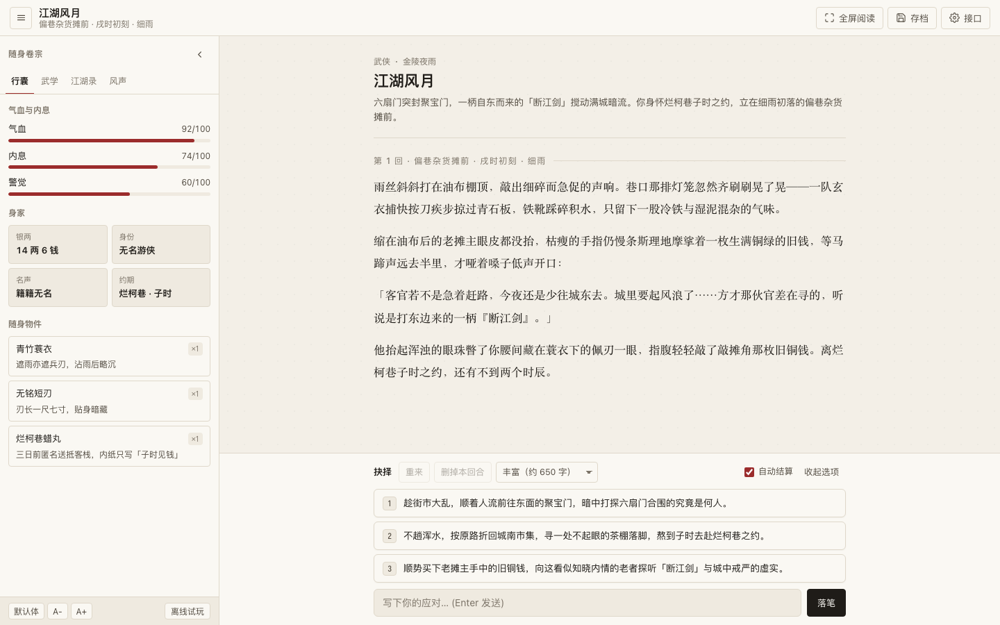
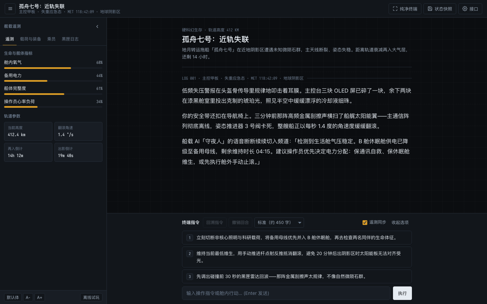
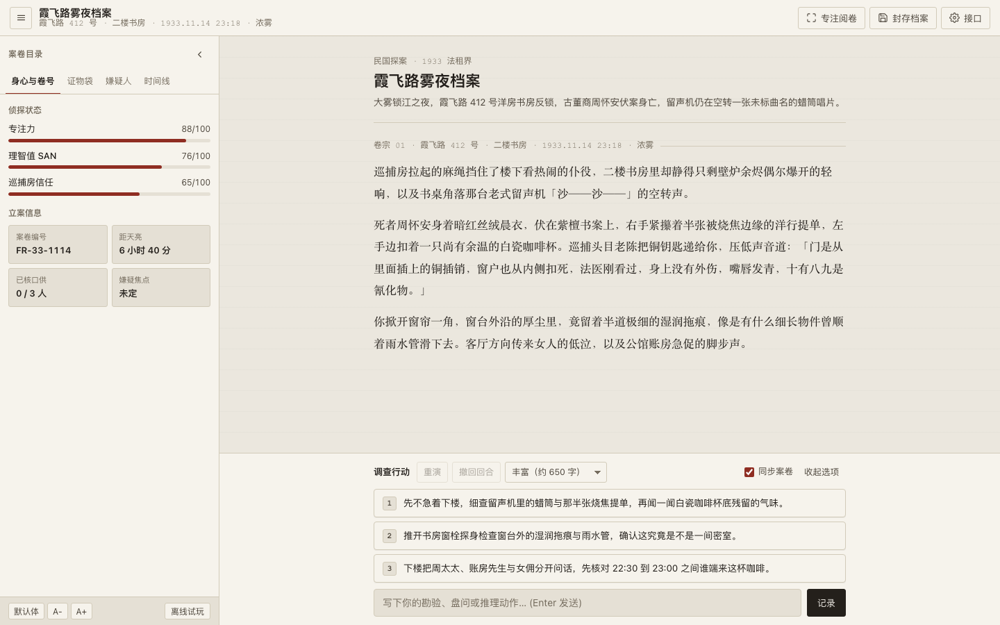
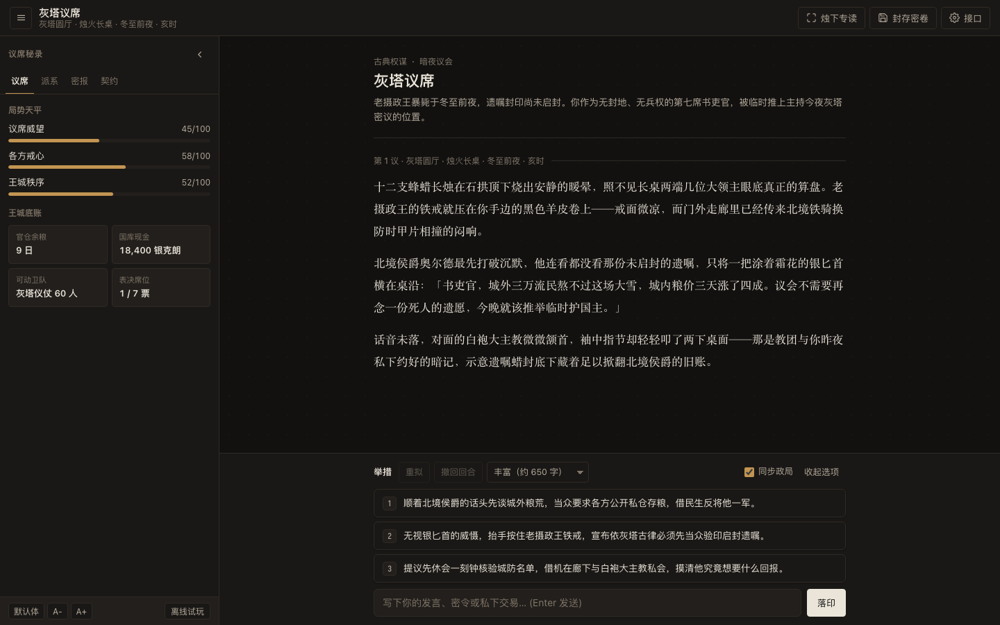
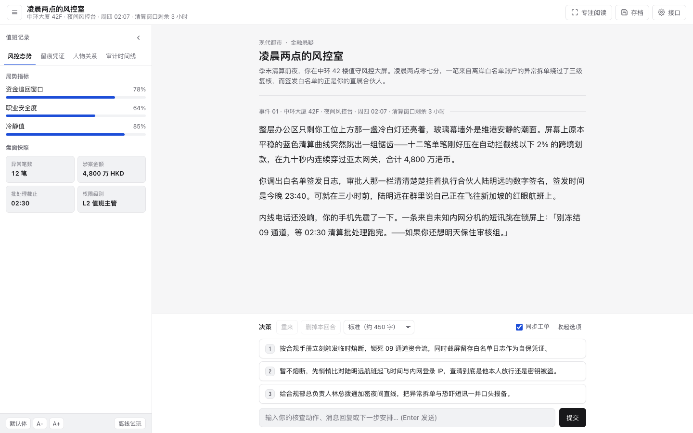

<div align="center">

# Wenyou

**Immersive single-file HTML interactive fiction (AIRP) platforms built by your AI — where tabs, state widgets and UI adapt to the story.**

A skill for Claude Code, Codex, Cursor and any agent that reads skills.<br>
No hardcoded RPG tabs. No neon templates. Five restrained atmospheric themes and one self-contained HTML file that runs on desktop and phone.

[Examples](#five-stories-five-interfaces) · [Install](#install) · [How it works](#how-a-game-gets-built) · [简体中文](README.zh-CN.md)

[](LICENSE)
[](#install)
[](#install)
[](#how-a-game-gets-built)

</div>

```bash
npx skills add kehaoran-ai/wenyou
```

Then ask your agent for any interactive fiction story in plain words. It writes the story blueprint, compiles one self-contained `.html` file, checks it and hands it over ready to play.

## Why fixed templates break immersion

Ask most models to build an HTML text-adventure platform and every story comes out wearing the exact same skin: pastel cards, emoji icons, and four rigid tabs (`Status / Inventory / Quests / NPC`). A 1930s detective case feels identical to an orbital survival thriller.

Wenyou separates the **runtime engine** from the **story blueprint**:

- **Story-driven dynamic tabs.** Each story declares its own tabs and widgets (`meters`, `stats`, `tags`, `entities`, `timeline`, `notes`). Hidden tabs can unlock mid-story — and live models can even create brand-new tabs during play via `<<<GAME_STATE>>>`.
- **Five restrained atmospheric themes.** `ink-scroll` (xuan paper & cinnabar), `dossier` (aged case file), `terminal` (obsidian telemetry), `editorial` (modern publication) and `parchment-night` (candlelit council). In-world button labels and fullscreen reading mode keep you inside the fiction.
- **Real AIRP engine inside one HTML file.** SSE streaming, automatic state settlement, exact turn-snapshot rollback (`Retry` / `Delete turn`), output length presets, multi-slot `localStorage` saves + JSON export/import, and OpenAI-compatible API setup (DeepSeek, OpenAI, OpenRouter, Ollama).
- **Playable out of the box.** Every generated game includes an offline branching demo script so you can test streaming, dynamic tab unlocks and rollback before entering an API key.

## Five stories, five interfaces

Every example in `examples/` is a standalone HTML file compiled from its matching `.json` blueprint. Double-click any `.html` file to play offline or connect your own API key.

| | |
|---|---|
| <br>**[`jianghu-fengyue.html`](examples/jianghu-fengyue.html)** (`ink-scroll`): 武侠江湖 · 行囊 / 武学 / 江湖录 / 风声 / *暗卷* | <br>**[`orbital-drift.html`](examples/orbital-drift.html)** (`terminal`): 硬科幻生存 · 遥测 / 载荷与装备 / 乘员 / 黑匣日志 / *幽灵频段* |
| <br>**[`minguo-dossier.html`](examples/minguo-dossier.html)** (`dossier`): 民国探案 · 身心与卷号 / 证物袋 / 嫌疑人 / 时间线 / *密档* | <br>**[`grey-tower-council.html`](examples/grey-tower-council.html)** (`parchment-night`): 古典权谋 · 议席 / 派系 / 密报 / 契约 / *禁书库* |
| <br>**[`metro-night-shift.html`](examples/metro-night-shift.html)** (`editorial`): 现代金融悬疑 · 风控态势 / 留痕凭证 / 人物关系 / 审计时间线 / *离岸穿透* | **Every hidden tab unlocks mid-story.** Pick any opening choice in offline demo mode to see live streaming, state settlement, dynamic tab unlocking and exact rollback. |

## How a game gets built

1. **You describe the world.** "Build me an interactive 1933 Shanghai foggy-night murder mystery with evidence bags and suspect timelines."
2. **The agent writes only `story.json`.** It chooses a matching theme, invents story-native tabs, writes in-world UI labels, crafts the opening dilemma and configures the GM prompt.
3. **`build.py` compiles and checks.** It bundles the engine, themes and blueprint into one single `.html` file and runs `check.py` to catch schema errors, generic tab sets or emoji clutter.
4. **Open and play.** Works offline immediately; paste a DeepSeek or OpenAI-compatible key in the in-app API modal to play endlessly.

```bash
python3 skills/wenyou/scripts/build.py examples/jianghu-fengyue.json ./jianghu.html
```

## Install

**Claude Code**

```text
/plugin marketplace add kehaoran-ai/wenyou
/plugin install wenyou@wenyou
```

**Any agent that reads skills** (Claude Code, Codex, Cursor, etc.)

```bash
npx skills add kehaoran-ai/wenyou
```

**Manual**

```bash
git clone https://github.com/kehaoran-ai/wenyou
cp -r wenyou/skills/wenyou ~/.claude/skills/
```

## License

[MIT](LICENSE)
