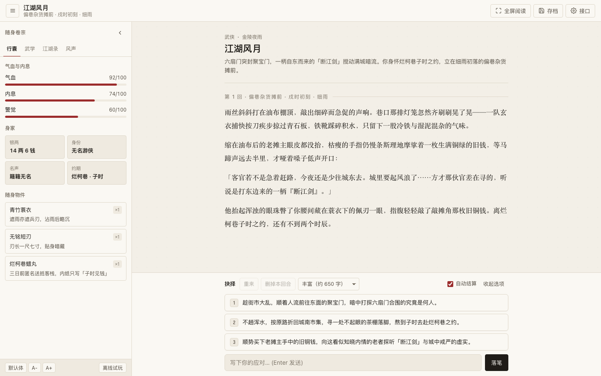
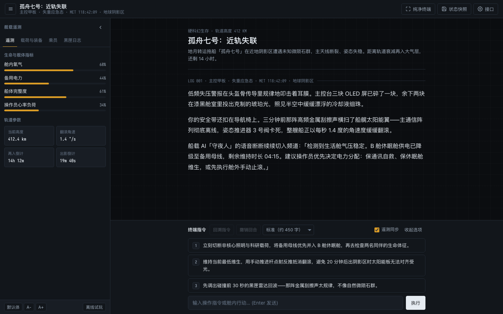
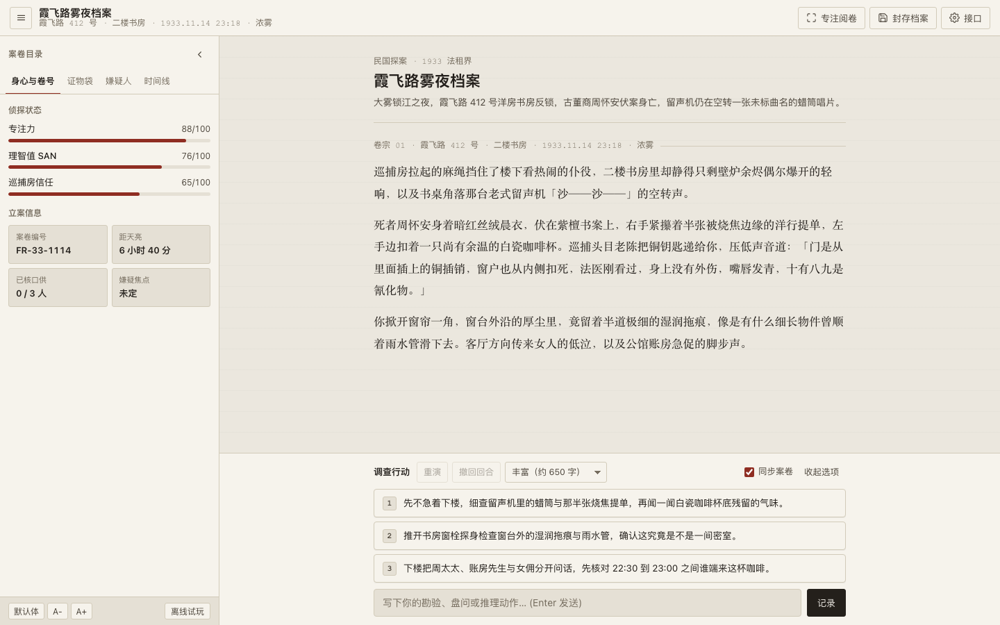
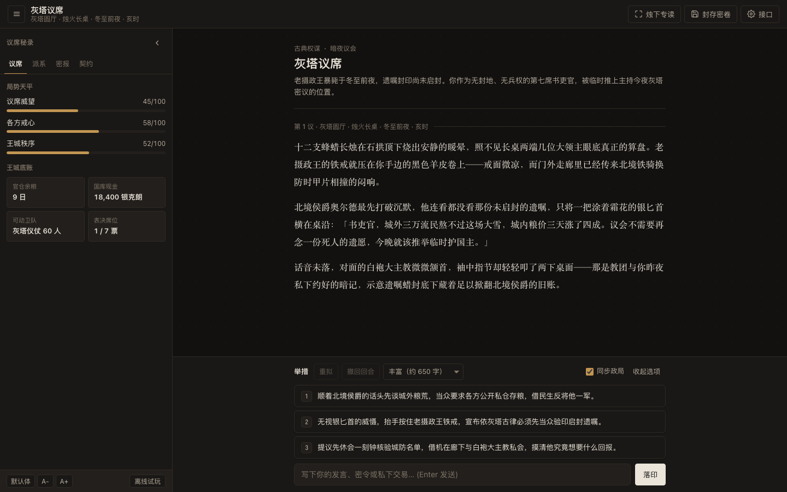
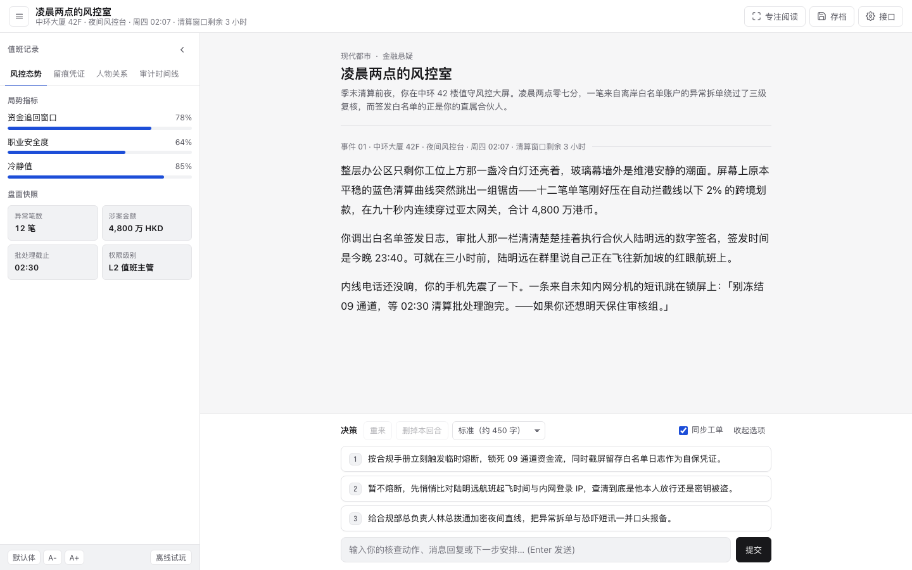

<div align="center">

# Wenyou（文游）

**让 AI 为每个故事量身定制单文件 HTML 互动文游平台：Tab 不固定，UI 跟着故事走，把沉浸感拉满。**

给 Claude Code、Codex、Cursor 等 AI 编程工具用的开源 skill。<br>
内置 5 套克制的题材沉浸皮肤、动态页签引擎、流式状态结算、精确回滚与 OpenAI 兼容接口支持，零构建，双击直接玩。

[五个案例](#五个题材五副面孔) · [安装](#安装) · [怎么构建](#一个文游是怎么做出来的) · [English](README.md)

[](LICENSE)
[](#安装)
[](#安装)
[](#一个文游是怎么做出来的)

</div>

```bash
npx skills add kehaoran-ai/wenyou
```

装好之后，直接告诉 AI 你想玩什么题材的文游。它会自动设计属于这个故事的动态页签、配色与开局，编译成一个电脑和手机都能直接打开的 `.html` 单文件。

## 为什么传统文游模板容易出戏

直接让模型手写一个文游前端，往往会出现两个问题：视觉退化成粉紫渐变加满屏 Emoji，而且无论玩武侠、民国探案还是太空失联，左边永远是写死的「状态 / 背包 / 任务 / NPC」。

Wenyou 把**引擎底座**和**故事蓝图**彻底拆开：

- **不固定 Tab，按故事动态生长。** 每个故事在 `story.json` 里自行定义页签与 6 类组件（数值条、键值面板、物品标签、人物志、时间线、密录笔记）。支持预埋隐藏页签并在剧情触发时动态解锁，真实模型游玩中还可通过 `<<<GAME_STATE>>>` 实时新增页签。
- **UI 跟着故事走，5 套克制沉浸皮肤。** `ink-scroll`（水墨笺纸）、`dossier`（旧档案）、`terminal`（冷光终端）、`editorial`（现代出版物）、`parchment-night`（暗夜书房）。连按钮文案、回合编号和全屏阅读态都贴合题材口吻，没有廉价光斑与装饰噪音。
- **完整 AIRP 游玩能力，全部内联单文件。** SSE 流式输出、正文与状态块分离解析、自动结算提示条、`重来 / 删掉本回合` 精确状态快照回滚、多档字数切换、多槽位本地存档与 JSON 导入导出、键盘 `1/2/3` 快捷抉择。
- **即开即玩，直连 DeepSeek 等接口。** 每个产物自带离线分支试玩脚本，双击就能体验流式叙事、状态更新与动态解锁新页签；点右上角「接口」填入 DeepSeek、OpenAI、OpenRouter 或本地 Ollama 即可无限续写（Key 只保存在本地浏览器）。

## 五个题材，五副面孔

`examples/` 下提供 5 个完整可玩单文件案例，每个案例使用不同皮肤与完全不同的动态页签结构，首回合互动均会触发隐藏页签解锁：

| | |
|---|---|
| <br>**[`jianghu-fengyue.html`](examples/jianghu-fengyue.html)**（`ink-scroll`）：武侠《江湖风月》· 行囊 / 武学 / 江湖录 / 风声 / *暗卷* | <br>**[`orbital-drift.html`](examples/orbital-drift.html)**（`terminal`）：硬科幻《孤舟七号》· 遥测 / 载荷与装备 / 乘员 / 黑匣日志 / *幽灵频段* |
| <br>**[`minguo-dossier.html`](examples/minguo-dossier.html)**（`dossier`）：民国探案《霞飞路雾夜档案》· 身心与卷号 / 证物袋 / 嫌疑人 / 时间线 / *密档* | <br>**[`grey-tower-council.html`](examples/grey-tower-council.html)**（`parchment-night`）：古典权谋《灰塔议席》· 议席 / 派系 / 密报 / 契约 / *禁书库* |
| <br>**[`metro-night-shift.html`](examples/metro-night-shift.html)**（`editorial`）：现代金融悬疑《凌晨两点的风控室》· 风控态势 / 留痕凭证 / 人物关系 / 审计时间线 / *离岸穿透* | **所有隐藏页签均在剧情中动态解锁。** 双击任意案例点选首回合选项，即可离线体验流式叙事、自动结算、动态新页签与精确状态回滚。 |

## 一个文游是怎么做出来的

1. **用大白话说题材。** 「给我做一个 1933 年上海法租界雾夜探案文游，要带证物袋和嫌疑人口供对比。」
2. **AI 只写故事蓝图 `story.json`。** 自动匹配皮肤、设计专属动态 Tab 与入戏文案、写出高张力开局和 GM 设定，不用重写上千行前端代码。
3. **`build.py` 编译并跑质检。** 自动合成零依赖单文件 HTML，并用 `check.py` 检查结构完整性、防通用模板退化和防 Emoji 污染。
4. **双击打开玩。** 桌面与手机自适应，支持一键进入纯文字全屏沉浸阅读。

```bash
python3 skills/wenyou/scripts/build.py examples/jianghu-fengyue.json ./jianghu.html
```

## 安装

**Claude Code**

```text
/plugin marketplace add kehaoran-ai/wenyou
/plugin install wenyou@wenyou
```

**任何支持 Agent Skills 的工具**（Claude Code、Codex、Cursor 等）

```bash
npx skills add kehaoran-ai/wenyou
```

**手动安装**

```bash
git clone https://github.com/kehaoran-ai/wenyou
cp -r wenyou/skills/wenyou ~/.claude/skills/
```

## 开源协议

[MIT](LICENSE)
